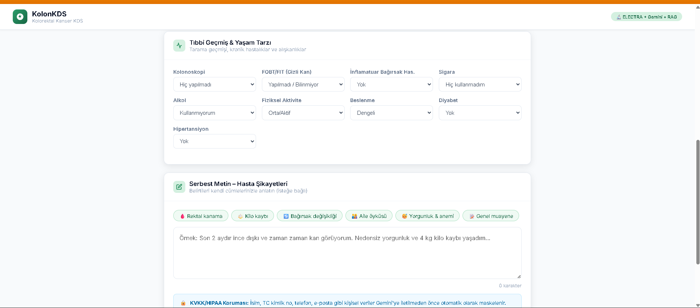
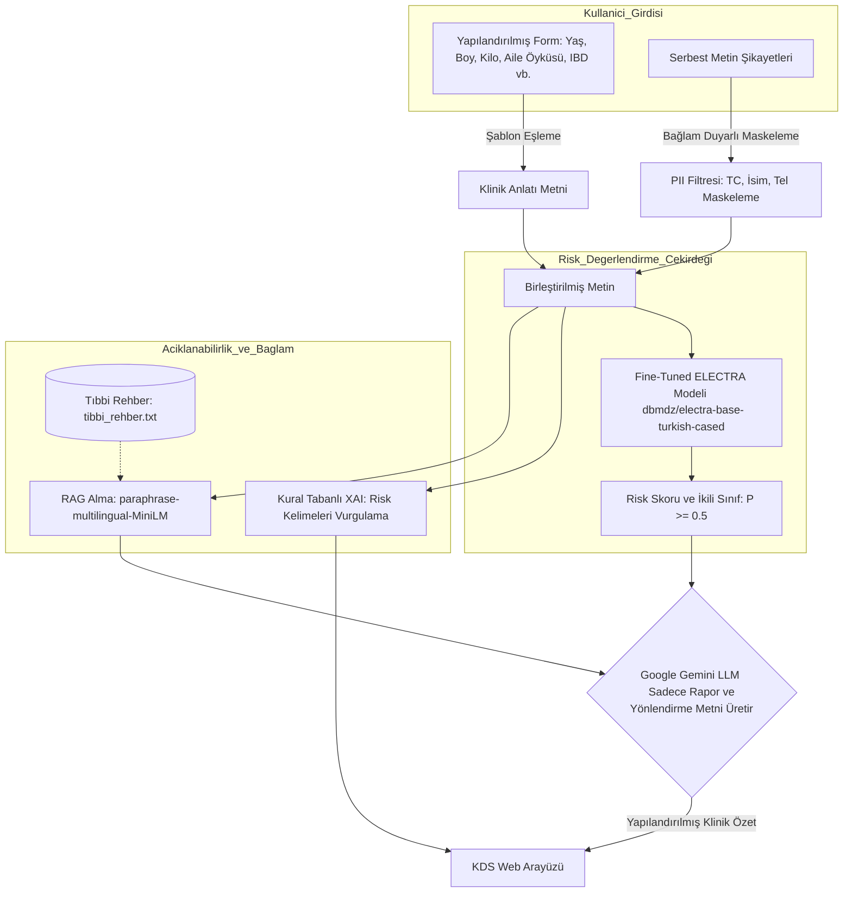

<div align="center">
  
  
  # Kolorektal Klinik Karar Destek Sistemi (KolonKDS)
  
  **ELECTRA Transformer, RAG Bilgi Tabanı ve Gemini Destekli Risk Değerlendirme ve Yönlendirme Platformu**
  
  [](https://huggingface.co/spaces/emirdfg/kolorektal-kds)
  [](https://www.python.org/)
  [](https://flask.palletsprojects.com/)
  [](LICENSE)
  
  [Canlı Uygulamaya Erişmek İçin Tıklayın (Hugging Face Spaces)](https://huggingface.co/spaces/emirdfg/kolorektal-kds)
</div>

---

> ⚠️ **ÖNEMLİ TIBBİ VE ETİK UYARI**  
> **Bu sistem kesin tanı (teşhis) koymaz.** Sistem, yapılandırılmış hasta verilerini ve şikayet metinlerini analiz ederek **risk olasılığı hesaplayan ve uygun uzman hekime yönlendirme önerisi sunan bir klinik karar destek prototipidir**. Elde edilen sonuçlar tıbbi bir rapor niteliği taşımayıp mutlaka bir Gastroenteroloji veya Genel Cerrahi uzmanı tarafından klinik ve endoskopik tetkiklerle doğrulanmalıdır.

---

## 1. Proje Özeti ve Gerçek Sistem Mimarisi

**KolonKDS**, bireylerin demografik bilgilerini, risk faktörlerini ve serbest metin formatında bildirdikleri semptomları değerlendirerek kolorektal kanser risk düzeyini hesaplayan ve anlaşılır klinik geri bildirim üreten bir karar destek aracıdır.

Sistemin üretim (production) çalışma mimarisi şu bileşenlerden oluşur:

1. **Girdi İşleme & PII Filtresi:** Kullanıcıdan web arayüzü üzerinden yapılandırılmış parametreler (yaş, cinsiyet, boy, kilo, aile öyküsü, kolonoskopi geçmişi, dışkıda gizli kan testi, IBD durumu, yaşam tarzı) ve serbest metin şikayetleri alınır. Kullanıcının serbest metni, KVKK/HIPAA uyumu için bağlam duyarlı PII filtresinden geçirilerek isim, TC kimlik, telefon, e-posta ve IBAN gibi kişisel veriler maskelenir.
2. **Doğal Dil Risk Sınıflandırıcısı (Tek Model):** Yapılandırılmış veriden üretilen klinik anlatı ile temizlenmiş serbest metin birleştirilir. Risk tahmini, Türkçe klinik/genel metinler için ince ayarı yapılmış **ELECTRA** (`dbmdz/electra-base-turkish-cased-discriminator`) transformer modeli tarafından gerçekleştirilir. Model çıktısı ikili sınıflandırmadır ($P_{risk} \ge 0.50$ durumunda yüksek risk etiketi verilir). Modelin aşırı duyarlılığını düzenlemek adına çıkarım aşamasında lojistik kaydırma ve sıcaklık ölçeklemesi ($T=2.9$) uygulanmıştır; ancak kalibrasyon ayrıca istatistiksel olarak ölçülmemiştir.
3. **Kural Tabanlı XAI (Risk Kelimesi Tespiti):** Arayüzde açıklanabilirliği artırmak amacıyla kural tabanlı bir risk sözlüğü (`RISK_KEYWORDS`) kullanılarak kritik ("kanama", "kilo kaybı", "anemi"), yüksek ("ince dışkı", "tenezm", "polip") ve orta risk ("sigara", "obezite", "diyabet") kelimeleri renkli olarak vurgulanır. *(Not: Bu modül SHAP veya attention analizi değil, sözlük eşleştirmesidir).*
4. **RAG Bilgi Tabanı:** `tibbi_rehber.txt` belgesi, çok dilli gömme modeli (`sentence-transformers/paraphrase-multilingual-MiniLM-L12-v2`) kullanılarak vektörleştirilmiştir. Hastanın anlatısıyla en yüksek kosinüs benzerliğine sahip ilk 3 rehber parçası dinamik olarak çekilir.
5. **LLM Açıklama Üretimi (Google Gemini):** Gemini LLM modeli kesinlikle tanı veya risk skoru üretmez; yalnızca ELECTRA'nın hesapladığı risk yüzdesini, tespit edilen belirtileri ve RAG'den gelen tıbbi rehber bağlamını alarak hasta için empatik, anlaşılır ve hekim kontrolünü teşvik eden yapılandırılmış bir özet rapor hazırlar.

---

## 2. Mimari Akış Şeması



---

## 3. Deneysel Sonuçlar ve Metrikler

Aşağıdaki metrikler, ilgili model eğitim defterlerinin (`notebooks/electra_model_train.ipynb` ve `notebooks/data_analyz_and_bert_model.ipynb`) test hücreleri çalıştırıldığında elde edilen kesin ve değiştirilmemiş değerlerdir:

| Model Mimarisi | Test Veri Boyutu | Accuracy (Doğruluk) | Precision (Kesinlik) | Recall (Duyarlılık) | F1-Score | AUC-ROC |
| :--- | :---: | :---: | :---: | :---: | :---: | :---: |
| **ELECTRA** (`electra-base-turkish-cased`) | 36.800 | **0.6958** | **1.0000** | **0.3917** | **0.5629** | - |
| **BERT** (`bert-base-turkish-cased`) | 34.133 | **0.7557** | **0.7092** | **1.0000** | **0.8299** | **0.7921** |

### Metrik Analizi ve Önemli Notlar:
1. **Dengelenmiş Test Kümeleri:** ELECTRA test seti %50 pozitif (18.400) ve %50 negatif (18.400) olacak şekilde dengelenmiştir.
2. **Örnekleme Sırası:** Ham anket verilerindeki aşırı sınıf dengesizliği nedeniyle eğitim öncesinde sentetik veri çoğaltma ve SMOTE uygulanmıştır. Bu durum modellerin duyarlılık-kesinlik dengesini etkilemektedir.
3. **ELECTRA Performansı:** ELECTRA modelinin test kümesinde yüksek kesinlik (1.00) ancak düşük duyarlılık (0.39) sergilemesi nedeniyle üretim ortamında (`KDS_Deploy/app.py`) lojistik kaydırma (`logits -= 4`) ve sıcaklık ölçeklemesi ($T=2.9$) eklenerek klinik risk hassasiyeti dengelenmeye çalışılmıştır.

---

## 4. Deneysel Defterler ve Karşılaştırmalı Ön Çalışmalar

Projenin geliştirme sürecinde yalnızca transformer modelleri değil, klasik makine öğrenmesi algoritmaları da araştırılmıştır. Bu çalışmalar `notebooks/` dizininde arşivlenmiştir:

- **`notebooks/data_analyz_and_bert_model.ipynb`**: BERT tabanlı doğal dil işleme modeli eğitimi ve detaylı metin analitiği.
- **`notebooks/electra_model_train.ipynb`**: Üretimde kullanılan ELECTRA modelinin Kaggle T4 GPU ortamındaki 3 epochluk eğitim defteri.
- **`notebooks/proceses_data.ipynb` & `notebook_model.ipynb`**: TF-IDF vektörizasyonu ile eğitilen XGBoost (Accuracy: %50.07) ve Lojistik Regresyon (Accuracy: %49.80) temel deneyleri.
- **`models/colorectal_model.pkl`**: Sayısal tablo özellikleri için geliştirilmiş deneysel Çok Katmanlı Algılayıcı (MLP) / Random Forest prototipi. *(Not: Canlı web uygulamasında çift model yerine metin tabanlı ELECTRA modeli tek öngörücü olarak kullanılmaktadır).*

---

## 5. Veri Güvenliği ve KVKK / HIPAA Uyumu

- **Stateless (Bellek İçi) Mimari:** Hugging Face Spaces üzerinde çalışan web uygulaması hiçbir veri tabanı bağlantısı barındırmaz; girilen kullanıcı şikayetlerini, form verilerini veya analiz sonuçlarını diske **kaydetmez**.
- **Bağlam Duyarlı PII Maskeleme:** Kullanıcıların girdiği serbest metinler analiz motoruna ve Gemini API'ye gönderilmeden önce yerel regex filtreleriyle taranır. TC kimlik numaraları, telefon numaraları, e-posta adresleri, IBAN'lar ve bağlamlı ad-soyad ifadeleri ("Adım Ahmet Yılmaz" $\rightarrow$ "Adım [İSİM]") otomatik olarak maskelenir.
- **Tıbbi Terimlerin Korunması:** "Dışkıda Gizli Kan Testi POZİTİF" veya "Ülseratif Kolit tanısı mevcut" gibi büyük harfle başlayan kritik tıbbi ifadelerin maskelenmemesi için isim tespiti sıkı bağlam koşullarına bağlanmıştır.

---

## 6. Sınırlılıklar

Projenin sentetik veri üretimi, vekil etiket kullanımı, harici klinik kohort doğrulaması eksikliği ve regülasyonel durumu hakkındaki ayrıntılı metodolojik sınırlılıklar için lütfen [docs/SINIRLILIKLAR.md](docs/SINIRLILIKLAR.md) belgesini inceleyiniz.

---

## 7. Kurulum ve Çalıştırma

### Adım 1: Depoyu Klonlayın
```bash
git clone https://github.com/kadir465/coleraktal_kds.git
cd coleraktal_kds
```

### Adım 2: Bağımlılıkları Yükleyin
```bash
python -m venv .venv
# Windows:
.venv\Scripts\activate
# Linux/macOS:
# source .venv/bin/activate

cd KDS_Deploy
pip install -r requirements.txt
```

### Adım 3: Ortam Değişkenlerini Tanımlayın
```bash
# Windows PowerShell:
$env:GEMINI_API_KEY="your_api_key_here"
$env:GEMINI_MODEL="gemini-1.5-flash"

# Linux / Bash:
export GEMINI_API_KEY="your_api_key_here"
export GEMINI_MODEL="gemini-1.5-flash"
```
*(Not: `GEMINI_API_KEY` tanımlanmasa dahi ELECTRA risk modeli yerel olarak çalışır; yalnızca LLM açıklaması devre dışı kalır).*

### Adım 4: Sunucuyu Başlatın
```bash
python app.py
```
Uygulama `http://localhost:7860` adresinde çalışacaktır.
